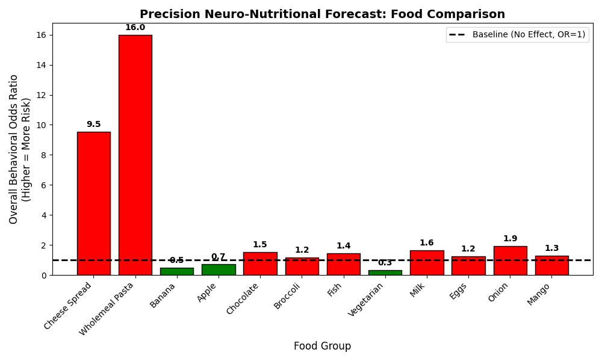

# Mining the Plate: Precision Neuro-Nutritional Behavioural Forecaster for Neurodivergent Children

[](https://doi.org/10.5281/zenodo.23580463)
[](https://opensource.org/licenses/MIT)
[](https://www.python.org/downloads/)

> **Reference Implementation & Codebase for:**  
> **"Mining the Plate: A Conceptual Framework for a Precision Neuro-Nutritional Behavioural Forecaster for Neurodivergent Children"**  
> *Pradeep Prabhu Bellikoth Ramesh*  
> Department of Computer Science, University of Colorado Boulder  
> Contact: `prbe9164@colorado.edu`

---

## ⚠️ Important Clinical & Ethical Notice

> **This repository presents a conceptual computational framework and reference implementation with hypothetical worked examples.**  
> It has **not** been clinically validated in children and **must not be used to diagnose, guide treatment, or restrict/eliminate foods from a child’s diet**.  
> Dietary modifications for children with Autism Spectrum Disorder (ASD) or Attention-Deficit/Hyperactivity Disorder (ADHD)—especially those presenting with selective eating or Avoidant/Restrictive Food Intake Disorder (ARFID)—should only ever be conducted under the direct supervision of a qualified clinician or registered dietitian.

---

## 📖 Overview

Current nutritional interventions for neurodevelopmental conditions (such as GFCF, Ketogenic, or Specific Carbohydrate Diets) are primarily **reactive** and rely on population-level trial-and-error protocols that impose significant caregiver burden without individualized predictive support.

**Mining the Plate** proposes a multi-modal precision forecasting framework uniting three core biological data streams:
1. **Genomic Baseline (Two-Sample Mendelian Randomisation):** Population-level causal estimates linking dietary exposures to neurodevelopmental phenotypes derived from GWAS summary statistics, serving as an individualized prior.
2. **Metabolic Stability Tracking:** Real-time assessment of postprandial glycemic buffering via the meal-level **Protein-to-Sugar ($P:S$) ratio**.
3. **Behavioural Signals as Time-Series:** Treating motor behaviors ("stims") not as pathology to suppress, but as candidate telemetry signals captured via wearable accelerometry and modeled with Distributed-Lag Non-Linear Models (DLNM) and Isolation Forest anomaly detection to identify potential gastrointestinal discomfort.

These inputs coalesce into the **Personalised Behavioural Risk Score (PBRS)**, an interpretable composite metric ranking candidate meals.

---

## 📐 Mathematical Formulation

The **Personalised Behavioural Risk Score (PBRS)** for a candidate food item $f$ is defined as:

$$\text{PBRS}(f) = \frac{G_r(f)}{M_s(f)} + B_p(f)$$

Where:
* **$G_r(f) \in [0, 10]$ (Genomic Risk):** Normalized causal risk scalar derived from Mendelian Randomisation (MR) log-odds ratios for dietary exposure $f$.
* **$M_s(f) \in [1, \infty)$ (Metabolic Stability):** Buffering divisor computed from the protein-to-sugar ratio:
  $$M_s(f) = 1 + \lambda \cdot (P:S)$$
  where $P:S = \min\left\{\frac{\text{Protein}}{\text{Sugar} + \varepsilon}, R_{\max}\right\}$ and $\lambda \ge 0$ is a child-specific calibration factor.
* **$B_p(f) \in [0, 5]$ (Biomarker Penalty):** Additive penalty triggered when dietary intake of $f$ is followed by a detectable stim cluster within the characteristic lag window $\hat{\tau}$:
  $$B_p(f) = B_{\max} \cdot \omega_M(f) \cdot \mathbb{I}[\hat{\tau} < \tau_{\text{threshold}} \wedge \text{stim cluster detected}]$$

### Indicative Tiers:
* **Low Risk:** $\text{PBRS} < 1.0$ (High behavioural regulation)
* **Moderate Risk:** $1.0 \le \text{PBRS} < 5.0$
* **High Risk:** $\text{PBRS} \ge 5.0$ (High probability of postprandial dysregulation)

---

## 📂 Repository Structure & Key Scripts

```text
├── precision.py               # Main source code: PBRS algorithm & scenario simulator
├── multiple.py                # Comparative bar chart generator (combined_food_forecast.png)
├── foododdration.py           # Precision forecast rules engine (microbiome & immune mediators)
├── forecast.py                # Random Forest ML feature importance pipeline on MR results
├── exportToCsv.py             # SAS / XPT dataset conversion utility
├── FullData.xlsx              # Multimodal MR summary dataset (Tables S1, S2, S6, S7, S8)
├── combined_food_forecast.png # Generated comparative odds ratio visualization
└── README.md                  # Project documentation
```

### Script Details

| Script | Role & Description |
| :--- | :--- |
| **`precision.py`** | **Primary Source Code.** Implements the three-tiered PBRS formula ($\text{Genomic Risk} / \text{Metabolic Stability} + \text{Biomarker Penalty}$). Evaluates candidate foods (e.g., Wholemeal pasta, Banana, Apple, Vegetable soup, Cheese spread) across varying macronutrient compositions and stim states. |
| **`multiple.py`** | **Comparative Visualization Engine.** Queries Inverse Variance Weighted (IVW) Mendelian Randomisation odds ratios from `FullData.xlsx`, formats risk tiers, and plots a comparative publication-grade bar chart (`combined_food_forecast.png`). |
| **`foododdration.py`** | Investigates downstream biological pathways: queries ASD risk (Table S2), immune & metabolite mediators (Table S8), and gut microbiome bacterial shifts (Table S7). |
| **`forecast.py`** | Trains a `RandomForestClassifier` on MR statistical features (`nsnp`, `b`, `se`, `or`) to predict significance and evaluate feature importance. |

---

## 📊 Visualizations

Running `multiple.py` produces the comparative neuro-nutritional risk forecast:



* **Red bars ($OR > 1.1$):** Elevated behavioral / diagnostic risk (e.g., Cheese spread, Wholemeal pasta).
* **Green bars ($OR < 0.9$):** Protective associations (e.g., Banana).
* **Gray bars ($0.9 \le OR \le 1.1$):** Neutral / baseline associations.

---

## 🚀 Getting Started

### 1. Prerequisites
* Python 3.8 or higher
* Recommended: Virtual environment (`venv` or `conda`)

### 2. Installation

Clone this repository and install required dependencies:

```bash
git clone https://github.com/brpradeepprabhu90/MiningThePlate.git
cd MiningThePlate
```

Create and activate a virtual environment:
```bash
python3 -m venv .venv
source .venv/bin/activate  # On Windows: .venv\Scripts\activate
```

Install the dependencies:
```bash
pip install pandas numpy matplotlib scikit-learn openpyxl pyreadstat
```

---

## 💻 Usage

### Calculate Personalized Behavioral Risk Scores (PBRS)
Run the core algorithmic engine:
```bash
python precision.py
```
*Output demonstrates scenario evaluations, displaying Tier 1 (Genomic Risk), Tier 2 (Metabolic Stability), Tier 3 (Biomarker Penalty), and the final composite PBRS score.*

### Generate Comparative Bar Chart
Generate and display the multi-food comparison plot:
```bash
python multiple.py
```
*The resulting plot is saved as `combined_food_forecast.png` and displayed interactively.*

### Query Biological Mediation & Microbiome Alterations
```bash
python foododdration.py
```

---

## 📑 Citation

If you use this conceptual framework, methodology, or code in your research, please cite:

```bibtex
@article{ramesh2026miningtheplate,
  title={Mining the Plate: A Conceptual Framework for a Precision Neuro-Nutritional Behavioural Forecaster for Neurodivergent Children},
  author={Ramesh, Pradeep Prabhu Bellikoth},
  journal={Preprint},
  year={2026},
  institution={Department of Computer Science, University of Colorado Boulder},
  doi={10.5281/zenodo.23580463},
  url={https://doi.org/10.5281/zenodo.23580463}
}
```

---

## 📄 License

This project is licensed under the MIT License - see the LICENSE file for details.

